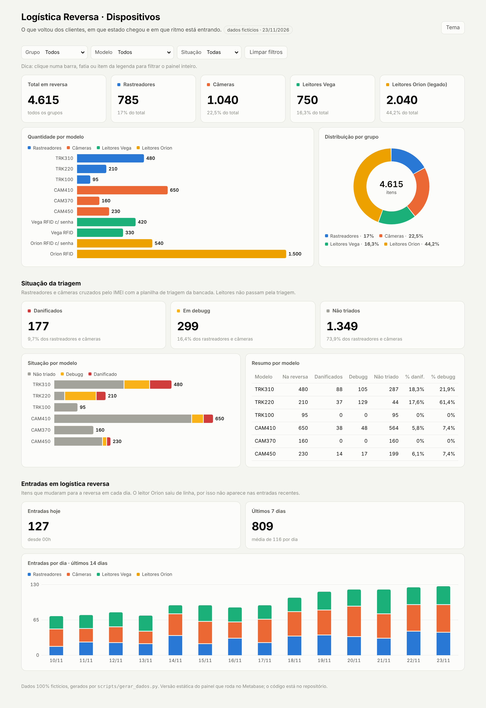

# Painel de Logística Reversa

Painel em Metabase para acompanhar os equipamentos de telemetria que voltam dos clientes: quantos estão parados na logística reversa, de que modelo, em que estado chegaram e em que ritmo estão entrando.

Este repositório é uma reconstrução do projeto que desenvolvi no trabalho, com **esquema genérico e dados 100% fictícios**. Os modelos, as marcas (Vega e Orion) e os números foram inventados. A lógica, os problemas encontrados e as decisões de modelagem são os mesmos do projeto original.

**[Ver a demo interativa](https://lucasmart7.github.io/painel-logistica-reversa/)**: versão estática do painel, roda no navegador sem instalar nada.



## O problema

A empresa tinha um painel de logística reversa que mostrava rastreadores, câmeras e os leitores RFID da linha atual. Dois problemas apareceram:

1. **Uma linha inteira de leitores não entrava na contagem.** A geração anterior de leitores RFID saiu de linha, mas continuava voltando dos clientes. Ela ficava na mesma tabela dos leitores atuais, sem nenhum campo que dissesse "isto é o modelo antigo", e por isso não aparecia no painel. Eram mais de 2 mil itens parados que ninguém via.
2. **Danificados e aptos apareciam misturados.** A equipe de bancada registrava o resultado da triagem numa planilha separada (debugg, dano físico, componente ausente). O painel não conversava com ela, então não dava para saber quanto do estoque em reversa podia ser reaproveitado.

## O que foi feito

### Achar o leitor que sumiu

A pista estava no número de série. Investigando a tabela de acessórios, os leitores se dividiam em dois padrões bem diferentes:

| | Leitor atual (Vega) | Leitor legado (Orion) |
|---|---|---|
| Número de série | 20 caracteres | 8 dígitos, começando por 23, 24 ou 25 |
| Observação | `vega` | vazia, ou o nome de um lote |
| Último cadastro | recente | parou de entrar quando saiu de linha |

A regra de classificação usa as duas coisas: a observação identifica o atual, e o formato da série (`^[0-9]{8}$`) identifica o legado. Registros que não se encaixam em nenhum dos dois ficam de fora em vez de serem chutados para um lado.

### Cruzar com a planilha de triagem

A planilha é cruzada com o sistema pelo IMEI. Na conferência apareceram problemas que o painel precisa tratar:

- **IMEIs repetidos**, às vezes com status diferentes ("Dano físico" numa linha, "Debugg" na outra). O painel fica com o status mais grave.
- **Aparelhos que a planilha dá como em reversa, mas o sistema não.** Eles não entram na contagem, e o script de importação lista quantos são para a equipe corrigir na origem.
- **"Sem pendência" dizia mais do que sabíamos.** A primeira versão chamava de "sem pendência" todo aparelho que não estava na planilha. Na prática isso queria dizer "ainda não triado", e modelos inteiros apareciam como 100% bons só porque ninguém tinha olhado. O rótulo virou **Não triado**.
- **Debugg não é dano.** Debugg costuma ser firmware ou configuração e tem conserto. O painel mostra os dois percentuais separados em vez de somar tudo como "pendência".

### Centralizar a regra numa visão

No projeto original a regra estava repetida em cada um dos 15 cards, e uma mudança (como incluir o leitor legado) precisava ser feita em todos. Aqui ela vive numa visão só, `vw_itens_reversa`, que devolve uma linha por item já com `modelo`, `grupo` e `situacao`. Os cards só contam e agrupam.

### Filtros que valem para o painel inteiro

Grupo, Modelo e Situação ficam no topo e atualizam todos os cards de uma vez. Cada consulta usa blocos opcionais do Metabase, que somem quando o filtro está vazio:

```sql
SELECT COUNT(*) AS total
FROM vw_itens_reversa
WHERE TRUE
  [[AND modelo = {{modelo}}]]
  [[AND grupo = {{grupo}}]]
  [[AND situacao = {{situacao}}]]
```

### Painel como código

O painel inteiro (consultas, layout, cores e filtros) está versionado neste repositório. O script `provisionar_metabase.py` lê esses arquivos e recria o painel pela API do Metabase, então o Git é a fonte da verdade e qualquer mudança passa por revisão.

## Estrutura

```
db/
  01_esquema.sql              tabelas: equipamentos, acessorios, triagem
  02_dados_ficticios.sql      carga gerada por scripts/gerar_dados.py
  03_visao_reversa.sql        vw_itens_reversa e vw_catalogo_modelos (a regra de negócio)
sql/consultas/                uma consulta por card, com as variáveis de filtro
metabase/painel.json          layout, tipo de gráfico, cores e filtros de cada card
scripts/
  gerar_dados.py              gera a base fictícia (semente fixa, reproduzível)
  importar_triagem.py         carrega o CSV da planilha e aponta inconsistências
  testar_consultas.py         roda as consultas no Postgres e confere se os totais batem
  provisionar_metabase.py     cria coleção, cards e dashboard pela API do Metabase
  gerar_demo.py               exporta os dados para a demo estática
docs/                         demo estática (index.html) e prints
```

## Como rodar

Precisa de Docker e Python 3.10 ou mais novo.

```bash
# 1. Sobe o Postgres (já com os dados fictícios) e o Metabase
docker compose up -d

# 2. Instala as dependências dos scripts
pip install -r requirements.txt

# 3. Confere as consultas direto no banco
PGHOST=localhost PGUSER=painel PGPASSWORD=painel PGDATABASE=painel \
  python scripts/testar_consultas.py

# 4. Abre http://localhost:3000 e cria o usuário administrador do Metabase

# 5. Cria o painel
MB_URL=http://localhost:3000 MB_USUARIO=seu@email.com MB_SENHA=suasenha \
  python scripts/provisionar_metabase.py
```

Na primeira execução o script cadastra o Postgres no Metabase. Rodar de novo arquiva a versão anterior e recria o painel a partir dos arquivos.

Para atualizar a triagem com uma nova exportação da planilha:

```bash
python scripts/importar_triagem.py caminho/da/planilha.csv
```

Para conferir um recorte específico, os filtros também funcionam no teste:

```bash
python scripts/testar_consultas.py --filtro grupo=Rastreadores --filtro situacao=Danificado
```

## Decisões e limites

- **A triagem só cobre rastreadores e câmeras.** Leitores sempre aparecem como "Não triado" e a seção de triagem diz isso no título, para o total de cima não parecer errado.
- **Os filtros aceitam um valor por vez.** Variáveis de texto no SQL nativo do Metabase não aceitam múltiplos valores de forma confiável entre versões, e um valor por vez cobre o uso real.
- **A demo estática não substitui o Metabase.** Ela existe para mostrar o resultado sem instalar nada. Os números vêm da mesma visão, exportados por `gerar_demo.py`.

## Tecnologias

PostgreSQL, SQL (CTEs, `DISTINCT ON`, `FILTER`, `generate_series`), Metabase e sua API REST, Python e Docker Compose. A demo usa HTML, CSS e JavaScript puros, com gráficos em SVG desenhados à mão.
